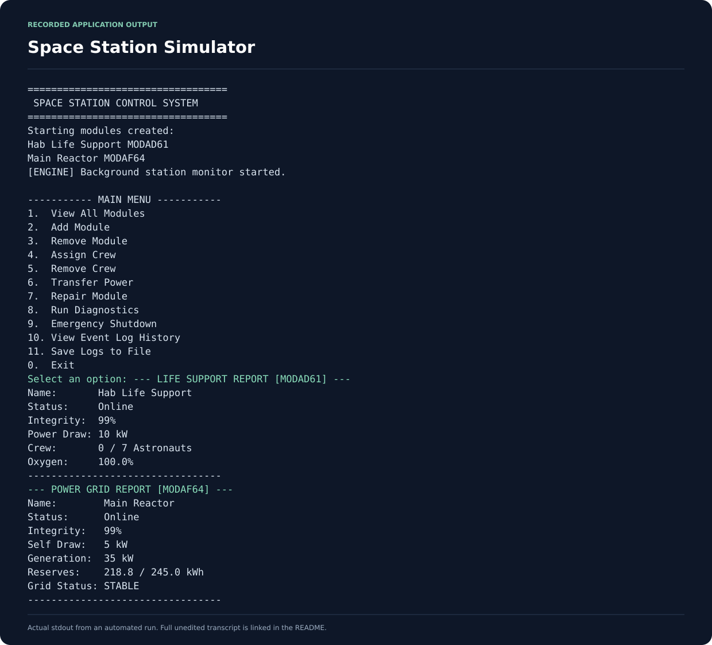

# Space Station Control Simulator

**Academic project · PRG 271 · C# / .NET Framework 4.7.2**

A console simulation of a space station with life-support and power-grid modules. A background monitor updates telemetry and raises alerts while the user manages modules through a numbered menu.

## Output preview

The image below presents output recorded from a real automated application run. It is a console-output excerpt; the program uses a terminal interface.

[Full unedited output](docs/screenshots/console-output.txt) · [Capture source and sample input](docs/screenshots/capture.json)

## What this demonstrates

- An abstract module base class with specialised life-support and power-grid implementations.
- Interface contracts for diagnostics, repair and telemetry logging.
- Custom domain exceptions and menu-level error handling.
- Event publishers and subscribers for alerts and maintenance requests.
- A background monitoring thread, cancellation and collection locking.
- Buffered event logs that can be appended to a text file.

## Run on Windows

Open **SpaceStation.sln** in Visual Studio with the .NET desktop development workload. Restore NuGet packages, select the SpaceStationSimulator project and run it.

The project targets **.NET Framework 4.7.2**. The reference-assemblies package supplies build references; running the application requires a compatible Windows .NET Framework runtime.

From a Visual Studio Developer PowerShell:

~~~powershell
msbuild SpaceStation.sln /restore /p:Configuration=Release
.\src\SpaceStationSimulator\bin\Release\SpaceStationSimulator.exe
~~~

## Try the simulation

1. Choose **1** to view the two modules created at startup.
2. Copy a module ID from the console when using crew, repair or power commands.
3. Use **8** for diagnostics and **10** to inspect event history.
4. Use **11** to save buffered logs.
5. Choose **0** to stop the background monitor and exit.

Module IDs and starting capacities are generated at runtime.

## Code organisation

| Path | Responsibility |
| --- | --- |
| SpaceStation.sln | Solution entry point |
| src/SpaceStationSimulator/ | C# source, project configuration and assembly metadata |
| Module.cs, LifeSupportModule.cs, PowerGridModule.cs | Module state and simulation behaviour |
| SimulationEngine.cs | Module operations and monitoring lifecycle |
| StationMonitor.cs, StationEventSubscriber.cs | Alert and maintenance events |
| StationLogger.cs | Buffered text logging |
| .github/workflows/ci.yml | Windows build and console smoke checks |

~~~mermaid
flowchart TD
    UI["Console menu"] --> Engine["Simulation engine"]
    Engine --> Modules["Station modules"]
    Engine --> Monitor["Station monitor"]
    Monitor --> Handlers["Event subscribers"]
    Handlers --> Logger["Text logger"]
~~~

The source namespace remains PRG_Project to preserve the original coursework implementation. Generated bin/obj output and runtime logs are excluded from version control.

## Scope

This is an educational simulation. Station state exists in memory; logs can be written to station_log.txt in the working directory. It does not connect to hardware or provide a graphical interface.

